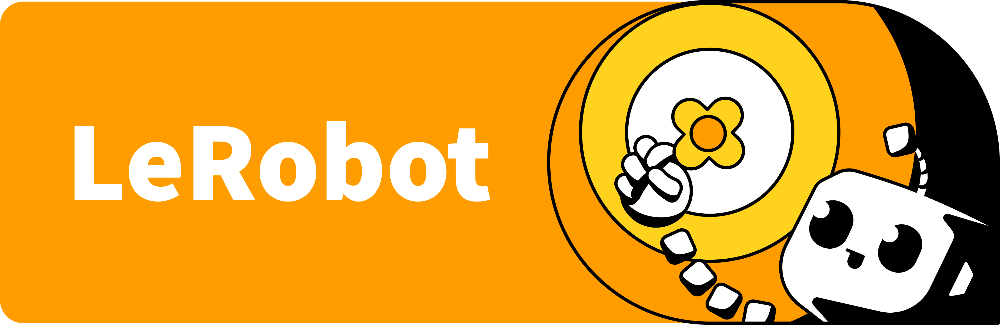
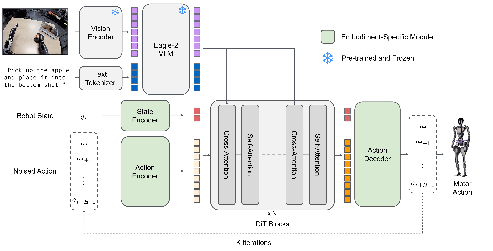
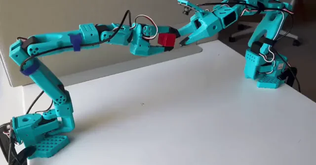

# SmolVLA 与 GR00T 的 Force FP16 推理实验

## SmolVLA 离线精度复测

在仓库根目录下载 SmolVLA 策略、归一化参数和 SmolVLM2 处理器。脚本从完整的策略 checkpoint 加载视觉语言模型和动作专家，因此 backbone 目录只需提供配置和分词文件。

```bash
hf download lerobot/smolvla_base \
  --revision 5e8d12a6e2975b0e5e5fce7c8caf47c371d257b6 \
  --local-dir checkpoints/smolvla_base
hf download HuggingFaceTB/SmolVLM2-500M-Video-Instruct \
  --revision 4cde9d208e19519c36917aa170fffc7e381aa0ad \
  config.json preprocessor_config.json processor_config.json tokenizer.json tokenizer_config.json \
  special_tokens_map.json added_tokens.json chat_template.json vocab.json merges.txt \
  --local-dir checkpoints/SmolVLM2-500M-Video-Instruct
```

在 Python 3.12+ 和 CUDA PyTorch 环境中运行：

```bash
HF_HUB_OFFLINE=1 uv run --locked --extra smolvla python -m examples.smolvla_fp16.verify_fp16 --repeats 2
HF_HUB_OFFLINE=1 uv run --locked --extra smolvla python -m examples.smolvla_fp16.export_baseline
```

本实验固定使用 2 步 Flow Matching。图像、状态与初始噪声直接以 FP16 生成，词元编号和掩码保留原类型。预处理、模型前向和动作反归一化都在 Force FP16 上下文中执行，逐算子检查浮点输出。RMSNorm 在平方前按行最大绝对值缩放，降低溢出风险。CUDA 关闭 TF32 并允许 FP16 矩阵乘累加。逐算子检查覆盖 PyTorch 可见张量，内核内部的累加精度取决于实现。

默认选用权重包中 `so100.buffer.action` 的 6 组均值和标准差，逐维执行 FP16 乘法，再执行 FP16 加法。两台设备需选用同一组参数。使用其他参数时，通过 `--action-stats-key` 指定，导出包的 `action_stats_key` 字段记录实际选择。

第一条命令检查相同输入的重复推理结果。可加 `--compare-fp32` 单独运行 FP32 参考推理。第二条命令导出 10 条算例，并从磁盘逐条回放两次。跨设备评分使用 NX 按此配置导出的基准包，比较形状为 `[1,50,6]` 的 **FP16 反归一化最终动作**。[基准格式与回放示例](examples/smolvla_fp16/BASELINE.md)

## GR00T N1.7 纯 FP16 推理与精度复测

这是 [huggingface/lerobot](https://github.com/huggingface/lerobot) 在 `8476881` 处的快照，加入了 GR00T N1.7 的 FP16 数值实验。`pure_fp16` 将 RMSNorm/RoPE 改为 FP16；**Force FP16** 在此基础上强制模型其余显式浮点张量运算也使用 FP16。预处理、后处理及 CUDA 内核内部累加精度保持原实现。本节之后是上游原版 README。

## Force FP16：当前实验方案与 NX 基准

`pure_fp16=True` 已经使用缩放 RMSNorm，但视觉位置插值、时间编码等仍有 FP32 运算。Force FP16 在该配置上额外套用 `examples/groot_fp16/full_fp16_experiment.py` 的 `full_fp16()` 上下文，并逐算子检查浮点输出。它用于单线程数值实验；Python 调度有额外开销，计时不能当作部署性能。

```python
from examples.groot_fp16.full_fp16_experiment import full_fp16

# policy 需使用 dtype=torch.float16, use_bf16=False, pure_fp16=True 加载。
# pre 和 post 必须是同一套关联的处理器；相对动作解码依赖 pre 缓存的当前状态。
model_input = pre(raw_batch)
with torch.inference_mode():
    with full_fp16():
        raw_actions = policy.predict_action_chunk(model_input, noise=fixed_noise)
    actions = post(raw_actions)
```

### 100 条可下载的固定基准

[Release：force-fp16-baseline-v1](https://github.com/Ideal-ljl/lerobot-groot-fp16/releases/tag/force-fp16-baseline-v1) 包含约 235 MB 的压缩包与 SHA256 校验文件。大数据存放在 Release 附件中，代码保存在本仓库。

包内包含两路图像、状态、指令、固定初始噪声、逐条模型输入、原始输出 `[100,40,132]`、最终动作 `[100,40,17]`、配置/环境和源码快照。数据是合成 DROID 观测，不是真实机器人任务评测。权重不包含在包中；准确 revision 和哈希见 `manifest.json`。

下载两个附件并解压后，在仓库根目录运行（比较工具只需要 NumPy）：

```bash
sha256sum -c force_fp16_baseline_100_v1.tar.gz.sha256
tar -xzf force_fp16_baseline_100_v1.tar.gz
uv run --no-project --with numpy python examples/groot_fp16/baseline_tools.py \
  --bundle ./force_fp16_baseline_100_v1 verify
uv run --no-project --with numpy python examples/groot_fp16/baseline_tools.py \
  --bundle ./force_fp16_baseline_100_v1 compare candidate.npz --output comparison.json
```

`candidate.npz` 必须含原顺序的 `case_ids`、`input_sha256`，以及目标项目计算的 `raw` 和/或 `decoded`。默认容差为 0；也可显式传入 `--atol`、`--rtol`。形状、dtype、解码与输入读取细节见包内 `README.txt`。

### 在本仓库回放或复查 20 条 × 3 轮

模型运行要求 Python 3.12+、适配设备的 CUDA PyTorch 及 GR00T 依赖。使用本机已有环境时，可在下列命令的 `uv run` 后添加 `--no-project --python /path/to/python`，避免重建环境。

```bash
uv run python examples/groot_fp16/replay_baseline.py \
  --bundle ./force_fp16_baseline_100_v1 \
  --ckpt ./checkpoints/GR00T-N1.7-3B \
  --cases 20 --repeats 3 --out outputs/force_fp16_replay_20x3
```

默认直接使用保存的模型输入；`--input-mode raw` 则重新预处理原始观测，并要求张量与保存值完全一致。两种路径都会先用当前观测刷新解码状态。每轮结果保存为 `round_N.npz`，重复性与基准偏差保存为 `summary.json`。回放全部基准使用 `--cases 100`；100 条的结果可以直接交给上面的比较工具。

NX 本次 20 条 × 3 轮的原始输出和最终动作全部逐位一致，轮间最大差值为 0。另一次 100 条导出的最终动作均与此前 Force FP16 输出一致。跨设备应使用保存的数组和噪声，不能只依赖相同种子重新生成输入。

### 消融实验与重新导出

以下脚本复现本地实验过程，从仓库根目录运行。`--ckpt` 和 `--processor` 均为本地目录；processor 使用配套 Cosmos-Reason2-2B 的 tokenizer/config 文件，无需下载其模型权重。

```bash
uv run python examples/groot_fp16/run_groot_rms_ablation.py \
  --ckpt ./checkpoints/GR00T-N1.7-3B --processor ./checkpoints/Cosmos-Reason2-2B \
  --cases 100 --repeats 2 --out outputs/groot_rms_ablation
uv run python examples/groot_fp16/run_force_fp16_repeatability.py \
  --ckpt ./checkpoints/GR00T-N1.7-3B --processor ./checkpoints/Cosmos-Reason2-2B \
  --source outputs/groot_rms_ablation --out outputs/force_fp16_20x3
uv run python examples/groot_fp16/export_force_fp16_baseline.py \
  --ckpt ./checkpoints/GR00T-N1.7-3B --processor ./checkpoints/Cosmos-Reason2-2B \
  --source outputs/groot_rms_ablation --out outputs/force_fp16_baseline_new
uv run python examples/groot_fp16/package_baseline.py outputs/force_fp16_baseline_new
```

导出脚本从输入目录读取精确的 100 条输入及 Force FP16 结果，重新推理并校验一致性。checkpoint 目录需包含原下载时的 `download_manifest.json`（含 `revision`）；脚本重新计算权重 SHA256。现有 v1 Release 保留原始本机脚本快照，包括 Python 3.10 的本机兼容处理；上面的正式脚本按仓库支持的 Python 版本运行。

NX 的 100 条消融结果，以本机默认 FP16（保留原有 FP32 运算）为基准，M 为每条最大归一化动作误差：

| 模式 | M > 10% | M 中位数 | M 最大值 |
|---|---:|---:|---:|
| 全 FP16，朴素 RMSNorm | 98/100 | 90.78% | 103.06% |
| **Force FP16（缩放 RMSNorm）** | **0/100** | **0.70%** | **5.54%** |
| `pure_fp16` | 0/100 | 0.19% | 3.44% |

历史结果字段 `full_fp16_scaled` 表示 Force FP16，`backbone_scaled` 表示 `pure_fp16`。下方 A100 实验使用不同参考，数字不能直接与本表比较。

## 为什么需要这个改动

transformers 的 Qwen3-VL 即使在 FP16 下运行，也会把两类计算放回 FP32：

- RMSNorm 的方差计算
- 文本和视觉 RoPE 的 cos/sin（视觉部分还包括旋转本身）

只把 RMSNorm 改成 FP16 不行。GR00T N1.7 的 backbone 从第 12 层起有一个和输入无关的超大激活：第 0 个 token 的第 1793 通道，|x| ≈ 15300。它的 x² 超过 FP16 上限 65504，方差变成 inf，`rsqrt(inf)=0`，这个 token 被整行清零，而且不会报 NaN。结果是 100 个用例里 98 个的动作误差超过 10%。

这里的解决办法是对 RMSNorm 做缩放：先算 s = max|x|，再归一化 y = x/s，即 `w·y·rsqrt(mean(y²) + (√eps/s)²)`。数学上它和原式相等，全程都是 FP16，也不会溢出。

## 改动内容

| 文件 | 内容 |
|---|---|
| `src/lerobot/policies/groot/fp16_precision.py` | 包含 `fp16_safe_rms_norm`、`enable_pure_fp16(module)` 和 `pure_fp16_vision_rope()`。`enable_pure_fp16` 只替换传入模块里的实例，`pure_fp16_vision_rope()` 是上下文管理器，退出时会恢复 transformers 的全局函数 |
| `configuration_groot.py` | 新增 `pure_fp16: bool = False`，`dtype` 允许设为 `torch.float16`。FP16 必须配合 `use_bf16=False` 使用，`pure_fp16=True` 必须配合 `dtype=float16` |
| `modeling_groot.py` / `groot_n1_7.py` | 按配置把模型转成 FP16，并启用纯 FP16 |
| `tests/policies/groot/test_groot_fp16_precision.py` | 5 个单元测试，见下文测试 1 |
| `examples/groot_fp16/verify_fp16.py` | 整模型精度复测脚本，见下文测试 2 |
| `examples/groot_fp16/reference_a100.npz` | A100 上 fp32、fp16、fp16_pure 三种模式的动作输出，以及每个用例输入的 sha256 |

使用方法：

```python
policy = GrootPolicy.from_pretrained(
    "nvidia/GR00T-N1.7-3B", embodiment_tag="oxe_droid_relative_eef_relative_joint",
    dtype=torch.float16, use_bf16=False, pure_fp16=True,
)
```

## 在新设备上需要做的测试

### 0. 环境准备

lerobot 要求 Python 3.12 及以上。Jetson 上需要先装好与 JetPack 对应、带 CUDA 的 PyTorch，再安装本仓库：

```bash
git clone https://github.com/Ideal-ljl/lerobot-groot-fp16.git && cd lerobot-groot-fp16
pip install -e ".[groot]"
pip install pytest
hf download nvidia/GR00T-N1.7-3B --local-dir ./checkpoints/GR00T-N1.7-3B   # 约 6.5 GB
```

安装完先用这条命令确认 CUDA 可用：

```bash
python -c "import torch; print(torch.cuda.is_available())"
```

### 1. 单元测试（不需要权重，几秒完成）

```bash
pytest tests/policies/groot/test_groot_fp16_precision.py -v
```

5 个测试应该全部通过，分别验证：

- 带超大激活时，缩放 RMSNorm 与 FP32 结果一致
- 朴素 FP16 RMSNorm 确实会把该 token 清零，说明这个改动是必要的
- `enable_pure_fp16` 只替换传入的模块，并且可以重复调用
- 纯 FP16 模式下视觉 RoPE 以 FP16 计算，退出后全局函数已恢复
- 配置校验规则生效

### 2. 整模型 FP16 精度复测（需要权重和 GPU）

```bash
python examples/groot_fp16/verify_fp16.py \
  --ckpt ./checkpoints/GR00T-N1.7-3B --out ./fp16_results
```

脚本做了这些事：

- **用例**：生成 100 个合成的 DROID 用例，在 CPU 上用固定种子生成；不同 PyTorch/平台不保证逐位一致，必须检查输入哈希。每个用例包含：
  - state：在 q01–q99 之间均匀采样
  - 两路 256×256 平滑随机图像
  - 一条任务文本
  - 固定的 FP16 初始噪声
- **模式**：默认跑 `fp16`（transformers 默认行为，RMSNorm/RoPE 仍用 FP32）和 `fp16_pure`（本改动）两种，各跑 2 遍。
- **对比基准**：结果与 `reference_a100.npz` 里 A100 的 FP32 输出比较。

内存够的话可以加上 `--modes fp32 fp16 fp16_pure`，在本机也跑一遍 FP32 作为基准。FP32 权重约 13 GB，16 GB 的 Orin NX 大概率放不下，所以默认使用 A100 的结果作为基准。

想先快速确认流程能跑通，可以加 `--cases 5 --repeats 1`。

**误差指标**：每个动作维度的误差为 |a − ref| / (q99 − q01)，单位是 %。对一个用例，E 是这些误差的均值，M 是最大值。

**判定**：输出最后打印 `fp16_pure: PASS` 即为通过，需要同时满足以下条件（对应 `summary.json` 里的 `fp16_pure_checks`）：

| 检查项 | 含义 |
|---|---|
| `inputs_identical` | 输入的 sha256 与 A100 运行时逐个用例一致，否则误差没有可比性 |
| `pure_fp16_enabled` | backbone 的 RMSNorm 类已换成 `PureFP16Qwen3VLTextRMSNorm` |
| `vision_rope_global_restored` | 退出后 transformers 的全局函数已恢复 |
| `no_violation` | 没有非有限值，也没有用例的 M 超过 10% |

**其他输出**（写入 `fp16_results/summary.json`，动作写入 `actions.npz`）：

| 字段 | 含义 |
|---|---|
| `repeat_bitexact_cases` | 两次运行逐位相同的用例数。A100 上是 100/100，不一致说明设备上的 kernel 结果不确定 |
| `vs_a100_same_mode_max_abs_diff` | 与 A100 同一模式的最大绝对差，反映不同硬件间的差异 |
| `latency_s_median` | 单个用例 `predict_action_chunk` 的耗时中位数，不含首次预热，只作参考 |
| `peak_mem_gib` | 峰值显存 |

### A100 参考结果（100 个用例，与 A100 FP32 对比）

| 模式 | M > 10% 的用例 | M 最大值 | M 中位数 | M p95 | E 均值 | 重复运行逐位一致 |
|---|---|---|---|---|---|---|
| fp16（RMSNorm/RoPE 用 FP32） | 0/100 | 2.85% | 0.19% | 1.68% | 0.032% | 100/100 |
| **fp16_pure（本改动）** | **0/100** | **4.78%** | **0.22%** | **1.73%** | **0.036%** | **100/100** |
| fp16_pure 但不缩放 RMSNorm（朴素） | 98/100 | — | — | — | — | — |

另外在 x86 CPU 上跑了前 2 个用例做交叉检查：CPU FP32 与 A100 FP32 的 M 最大值为 0.23%，CPU fp16_pure 与 A100 FP32 的 M 最大值为 1.04%，结果为 PASS。

如果新设备上 `fp16_pure` 的 M 明显高于上表，而 `fp16` 正常，通常是芯片的 FP16 归约、rsqrt 或 RoPE 实现有问题。如果两种模式都偏高，问题更可能出在 GEMM/SDPA 的累加精度上。

---

<p align="center">
  
</p>

<div align="center">

[](https://github.com/huggingface/lerobot/actions/workflows/latest_deps_tests.yml?query=branch%3Amain)
[](https://github.com/huggingface/lerobot/actions/workflows/docker_publish.yml?query=branch%3Amain)
[](https://www.python.org/downloads/)
[](https://github.com/huggingface/lerobot/blob/main/LICENSE)
[](https://pypi.org/project/lerobot/)
[](https://pypi.org/project/lerobot/)
[](https://github.com/huggingface/lerobot/blob/main/CODE_OF_CONDUCT.md)
[](https://discord.gg/s3KuuzsPFb)

</div>

**LeRobot** aims to provide models, datasets, and tools for real-world robotics in PyTorch. The goal is to lower the barrier to entry so that everyone can contribute to and benefit from shared datasets and pretrained models.

🤗 A hardware-agnostic, Python-native interface that standardizes control across diverse platforms, from low-cost arms (SO-100) to humanoids.

🤗 A standardized, scalable LeRobotDataset format (Parquet + MP4 or images) hosted on the Hugging Face Hub, enabling efficient storage, streaming and visualization of massive robotic datasets.

🤗 State-of-the-art policies that have been shown to transfer to the real-world ready for training and deployment.

🤗 Comprehensive support for the open-source ecosystem to democratize physical AI.

## Quick Start

LeRobot can be installed directly from PyPI.

```bash
pip install lerobot
lerobot-info
```

The base install is lightweight. Add the extras you need, for example `pip install 'lerobot[dataset]'` to load datasets, `'lerobot[training]'` to train policies, or `'lerobot[core_scripts,feetech]'` to record with an SO-101 arm.

> [!IMPORTANT]
> For detailed installation guide, please see the [Installation Documentation](https://huggingface.co/docs/lerobot/installation).

## Robots & Control

<div align="center">
  
</div>

LeRobot provides a unified `Robot` class interface that decouples control logic from hardware specifics. It supports a wide range of robots and teleoperation devices.

```python
from lerobot.robots.myrobot import MyRobot

# Connect to a robot
robot = MyRobot(config=...)
robot.connect()

# Read observation and send action
obs = robot.get_observation()
action = model.select_action(obs)
robot.send_action(action)
```

**Supported Hardware:** SO101, OpenARM, LeKiwi, Unitree G1, reBot B601, Koch, HopeJR, OMX, EarthRover, Reachy2, Gamepads, Keyboards, Phones and more.

While these devices are natively integrated into the LeRobot codebase, the library is designed to be extensible. You can easily implement the Robot interface to utilize LeRobot's data collection, training, and visualization tools for your own custom robot.

For detailed hardware setup guides, see the [Hardware Documentation](https://huggingface.co/docs/lerobot/integrate_hardware).

## LeRobot Dataset

To solve the data fragmentation problem in robotics, we utilize the **LeRobotDataset** format.

- **Structure:** Synchronized MP4 videos (or images) for vision and Parquet files for state/action data.
- **HF Hub Integration:** Explore thousands of robotics datasets on the [Hugging Face Hub](https://huggingface.co/lerobot).
- **Tools:** Seamlessly delete episodes, split by indices/fractions, add/remove features, and merge multiple datasets.

```python
from lerobot.datasets.lerobot_dataset import LeRobotDataset

# Load a dataset from the Hub
dataset = LeRobotDataset("lerobot/aloha_mobile_cabinet")

# Access data (automatically handles video decoding)
episode_index=0
print(f"{dataset[episode_index]['action'].shape=}\n")
```

Learn more about it in the [LeRobotDataset Documentation](https://huggingface.co/docs/lerobot/lerobot-dataset-v3).

## SoTA Models

LeRobot implements state-of-the-art policies in pure PyTorch, covering Imitation Learning, Reinforcement Learning, Vision-Language-Action (VLA) models, World Models, and Reward Models, with more coming soon. It also provides you with the tools to instrument and inspect your training process.

<p align="center">
  
</p>

Training a policy is as simple as running a script configuration:

```bash
lerobot-train \
  --policy.type=act \
  --dataset.repo_id=lerobot/aloha_mobile_cabinet \
  --policy.push_to_hub=false
```

| Category                   | Models                                                                                                                                                                                                                                                                                                                                                                                                                                                                                                                                                                                                                  |
| -------------------------- | ----------------------------------------------------------------------------------------------------------------------------------------------------------------------------------------------------------------------------------------------------------------------------------------------------------------------------------------------------------------------------------------------------------------------------------------------------------------------------------------------------------------------------------------------------------------------------------------------------------------------- |
| **Imitation Learning**     | [ACT](./docs/source/policy_act_README.md), [Diffusion](./docs/source/policy_diffusion_README.md), [VQ-BeT](./docs/source/policy_vqbet_README.md), [Multitask DiT Policy](./docs/source/policy_multi_task_dit_README.md)                                                                                                                                                                                                                                                                                                                                                                                                 |
| **Reinforcement Learning** | [HIL-SERL](./docs/source/hilserl.mdx), [TDMPC](./docs/source/policy_tdmpc_README.md) & QC-FQL (coming soon)                                                                                                                                                                                                                                                                                                                                                                                                                                                                                                             |
| **VLAs Models**            | [Pi0](./docs/source/pi0.mdx), [Pi0Fast](./docs/source/pi0fast.mdx), [Pi0.5](./docs/source/pi05.mdx), [OpenGalaxea G0.5](./docs/source/g05.mdx), [FineART-VLA](./docs/source/fineart_vla.mdx), [GR00T N1.7](./docs/source/policy_groot_README.md), [SmolVLA](./docs/source/policy_smolvla_README.md), [XVLA](./docs/source/xvla.mdx), [EO-1](./docs/source/eo1.mdx), [MolmoAct2](./docs/source/molmoact2.mdx), [LingBot-VLA 2.0](./docs/source/lingbot_vla_v2.mdx), [WALL-OSS](./docs/source/walloss.mdx), [Wall-OSS-0.5](./docs/source/wall_oss_05.mdx), [EVO1](./docs/source/evo1.mdx), [DM05](./docs/source/dm05.mdx) |
| **World Models**           | [VLA-JEPA](./docs/source/vla_jepa.mdx), [LingBot-VA](./docs/source/lingbot_va.mdx), [FastWAM](./docs/source/fastwam.mdx), [Long-WAM](./docs/source/longwam.mdx), [LaWAM](./docs/source/lawam.mdx), [FLUX 3 Action](./docs/source/flux3.mdx), [Cosmos3](./docs/source/cosmos3.mdx), [Praxis-1](./docs/source/praxis.mdx)                                                                                                                                                                                                                                                                                                 |
| **Reward Models**          | [SARM](./docs/source/sarm.mdx), [TOPReward](./docs/source/topreward.mdx), [Robometer](./docs/source/robometer.mdx)                                                                                                                                                                                                                                                                                                                                                                                                                                                                                                      |

Similarly to the hardware, you can easily implement your own policy & leverage LeRobot's data collection, training, and visualization tools, and share your model to the HF Hub.

For detailed policy setup guides, see the [Policy Documentation](https://huggingface.co/docs/lerobot/bring_your_own_policies). For GPU/RAM requirements and expected training time per policy, see the [Compute Hardware Guide](https://huggingface.co/docs/lerobot/hardware_guide).

## Inference & Evaluation

Evaluate your policies in simulation with `lerobot-eval`. LeRobot supports standard benchmarks like **LIBERO**, **MetaWorld** and more to come. To run a trained policy on a real robot, use `lerobot-rollout` (see the [Policy Deployment Documentation](https://huggingface.co/docs/lerobot/inference)).

```bash
# Evaluate a policy on the LIBERO benchmark
lerobot-eval \
  --policy.path=lerobot/pi0_libero_finetuned \
  --env.type=libero \
  --env.task=libero_object \
  --eval.n_episodes=10
```

Learn how to implement your own simulation environment or benchmark and distribute it from the HF Hub by following the [EnvHub Documentation](https://huggingface.co/docs/lerobot/envhub).

### Third-Party Hardware

Beyond the natively supported hardware, the community maintains a growing ecosystem of plugins for other robots, teleoperators, cameras, and sensors - UFACTORY xArm, Universal Robots UR5e, Franka, AgileX Piper, Trossen WidowX, ARX5, I2RT YAM, GELLO, SpaceMouse, Meta Quest, ROS 2 bridges, tactile and depth cameras, and more.

Plugins are auto-discovered by package name: LeRobot imports any installed package prefixed with `lerobot_robot_`, `lerobot_teleoperator_`, or `lerobot_camera_`. Install one and use the `type` it registers straight from the CLI:

```bash
pip install lerobot_robot_<name> lerobot_teleoperator_<name>

lerobot-record \
  --robot.type=<robot_name> \
  --teleop.type=<teleoperator_name> \
  --dataset.repo_id=${HF_USER}/my-dataset
```

Browse the full list in the [Third-Party Robots & Teleoperators](https://huggingface.co/docs/lerobot/main/third_party_robots) and [Third-Party Cameras & Sensors](https://huggingface.co/docs/lerobot/main/third_party_sensors) documentation.

## Resources

- **[Documentation](https://huggingface.co/docs/lerobot/index):** The complete guide to tutorials & API.
- **[Chinese Tutorials: LeRobot+SO-ARM101中文教程-同济子豪兄](https://zihao-ai.feishu.cn/wiki/space/7589642043471924447)** Detailed doc for assembling, teleoperate, dataset, train, deploy. Verified by Seed Studio and 5 global hackathon players.
- **[Discord](https://discord.gg/s3KuuzsPFb):** Join the `LeRobot` server to discuss with the community.
- **[X](https://x.com/LeRobotHF):** Follow us on X to stay up-to-date with the latest developments.
- **[Robot Learning Tutorial](https://huggingface.co/spaces/lerobot/robot-learning-tutorial):** A free, hands-on course to learn robot learning using LeRobot.
- **[T-Shirt Folding Experiment](https://huggingface.co/spaces/lerobot/robot-folding):** An end-to-end demonstration of folding t-shirts with LeRobot.
- **[LeLab](https://github.com/huggingface/leLab):** A web interface for LeRobot — teleoperate, calibrate, record datasets, replay, and train your SO arm from the browser, no CLI required.

## Citation

If you use LeRobot in your project, please cite the GitHub repository to acknowledge the ongoing development and contributors:

```bibtex
@misc{cadene2024lerobot,
    author = {Cadene, Remi and Alibert, Simon and Soare, Alexander and Gallouedec, Quentin and Zouitine, Adil and Palma, Steven and Kooijmans, Pepijn and Aractingi, Michel and Shukor, Mustafa and Aubakirova, Dana and Russi, Martino and Capuano, Francesco and Pascal, Caroline and Choghari, Jade and Meftah, Khalil and Ellerbach, Maxime and Moss, Jess and Wolf, Thomas},
    title = {LeRobot: State-of-the-art Machine Learning for Real-World Robotics in Pytorch},
    howpublished = "\url{https://github.com/huggingface/lerobot}",
    year = {2024}
}
```

If you are referencing our research or the academic paper, please also cite our ICLR publication:

<details>
<summary><b>ICLR 2026 Paper</b></summary>

```bibtex
@inproceedings{cadenelerobot,
  title={LeRobot: An Open-Source Library for End-to-End Robot Learning},
  author={Cadene, Remi and Alibert, Simon and Capuano, Francesco and Aractingi, Michel and Zouitine, Adil and Kooijmans, Pepijn and Choghari, Jade and Russi, Martino and Pascal, Caroline and Palma, Steven and Shukor, Mustafa and Moss, Jess and Soare, Alexander and Aubakirova, Dana and Lhoest, Quentin and Gallou\'edec, Quentin and Wolf, Thomas},
  booktitle={The Fourteenth International Conference on Learning Representations},
  year={2026},
  url={https://arxiv.org/abs/2602.22818}
}
```

</details>

## Contribute

We welcome contributions from everyone in the community! To get started, please read our [CONTRIBUTING.md](https://github.com/huggingface/lerobot/blob/main/CONTRIBUTING.md) guide. Whether you're adding a new feature, improving documentation, or fixing a bug, your help and feedback are invaluable. We're incredibly excited about the future of open-source robotics and can't wait to work with you on what's next—thank you for your support!

<p align="center">
  
</p>

<div align="center">
<sub>Built by the <a href="https://huggingface.co/lerobot">LeRobot</a> team at <a href="https://huggingface.co">Hugging Face</a> with ❤️</sub>
</div>
